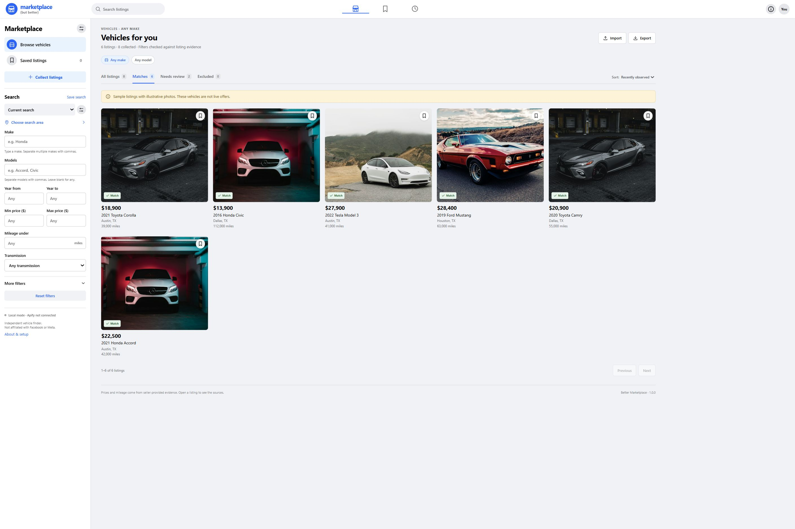
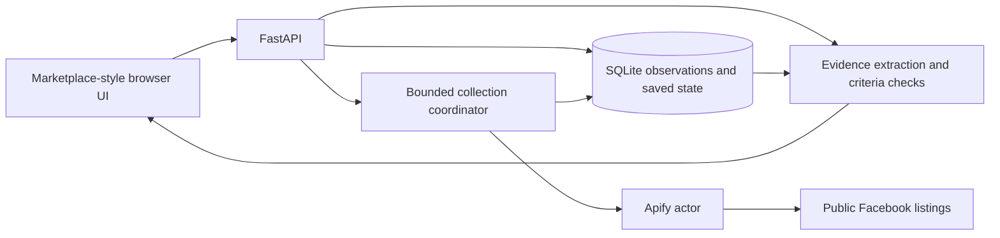

# Better Marketplace

**marketplace (but better)**

Search Facebook Marketplace vehicles with filters you can inspect.

Choose a make, models, year range, min and max price, mileage limit, and search area. Collect full listing details through Apify, then check the title, description, and vehicle fields in Python. Browse photo cards in a Marketplace-style interface, open the evidence, and save the cars worth following up on.



The screenshot uses synthetic listings and illustrative photos. This is an independent project, with no affiliation to Facebook, Meta, or Apify.

## Start locally

You need **Python 3.11+** and [uv](https://docs.astral.sh/uv/getting-started/installation/). The frontend ships as HTML, CSS, and JavaScript; you do not need Node.js or a frontend build step.

Clone the repository and install dependencies:

```bash
git clone https://github.com/nate-chambers/better-marketplace.git
cd better-marketplace
uv sync --locked
```

Create the environment file:

```powershell
# Windows PowerShell
Copy-Item .env.example .env
```

```bash
# macOS / Linux
cp .env.example .env
```

Start the app:

```bash
uv run better-marketplace serve
```

Open **[localhost:8768](http://localhost:8768)**. A new installation starts with an empty database and blank vehicle criteria: no selected make, models, years, price range, mileage limit, or cities. Enter your own criteria and add a search city before collecting. You can import listings without an API token.

### Try the sample collection

```bash
uv run better-marketplace demo
```

Demo mode uses a separate database under `data/demo/`. It includes fictional vehicles from several makes, a down-payment price, and a missing odometer. Set your own filters to inspect matches and exclusions. Demo mode does not create saved searches or choose vehicle criteria. The app labels the listings as samples and omits seller links. The bundled photos work offline after you install the dependencies. Stop the regular server before starting the demo on the same port.

To use a different port:

```bash
uv run better-marketplace serve --port 8770
```

For demo mode, set `MARKETPLACE_PORT=8770` in `.env` or your shell.

## Connect Apify

1. Create an Apify account and open [Settings → Integrations](https://console.apify.com/account/integrations).
2. Put your token in `.env`:

   ```dotenv
   APIFY_TOKEN=your_apify_token
   ```

3. Restart the server. The sidebar should say **Apify connected**.
4. Choose your vehicle criteria and locations. Click **Collect listings**.
5. Review the generated searches, maximum search count, and spending cap. Click **Start collection** to submit paid work.

The collector calls [`curious_coder/facebook-marketplace`](https://apify.com/curious_coder/facebook-marketplace). It requests full details, uses the Cars & Trucks category, and enables strict filtering. It does not pass Facebook cookies or implement login automation.

Your token stays in the server process. The browser receives a connection status, not the token. Git and Docker ignore `.env`, runtime databases, and run journals. The server loads `.env` from the current working directory without searching parent projects. An existing process environment takes precedence over the file.

### Costs and limits

The run dialog previews the actual search list before submission. Default server limits:

| Limit | Default |
| --- | ---: |
| Maximum budget per collection | $10 |
| Requested charge cap per actor run | $0.25 |
| Maximum searches per collection | 40 |
| Concurrent public actor runs | 4 |
| Actor timeout | 300 seconds |
| API maximum items per actor run | 250 |
| Maximum imported dataset records per run | 1,000 |

The dialog starts at a $2 budget and 8 searches. Increase those values to include a larger plan. A plan can contain more city/model combinations than the selected budget allows; the dialog lists the included combinations and tells you how many it omits.

Apify controls billing and actor availability. Check the actor’s current pricing before a larger collection. A charge cap, free-plan limit, page limit, or provider restriction can return fewer listings than expected. Some successful actor runs contain limit notices alongside listings. The app retains those notices in **Collection activity** and imports the valid listing rows.

Changing filters, saving a listing, and browsing collected data do not start paid work. The app has no recurring collection schedule.

### Account usage and credits

The sidebar shows **used / monthly spending limit** for the account connected by `APIFY_TOKEN`, a progress bar, the amount available before that limit, and the current cycle's end date. The same usage appears before you start a collection. Open **Plan & credits** to see the plan's included credits and a link to Apify billing.

These values come from Apify's [account limits](https://docs.apify.com/api/v2/users-me-limits-get) and [private user data](https://docs.apify.com/api/v2/users-me-get) endpoints. The app refreshes every minute while the page is visible, after a collection finishes, and when you click the refresh button. It reads the current account limit and plan allowance; neither is fixed at the Free plan's allowance. Changes reported by Apify appear on refresh.

**A spending limit is not a prepaid credit balance.** Paid accounts can have a spending limit above their included credits. These endpoints do not expose a reliable balance for purchased or promotional credits, so the app leaves `credit_balance_usd` unknown and links to billing for the exact balance. It does not infer cash or credit balances from the usage limit.

Usage includes all activity on the Apify account, including other apps. Billing updates may lag individual runs. Missing token permissions or an API outage show unavailable or clearly marked stale values. Only selected usage, plan, and cycle fields reach the browser; account profiles, email, and proxy credentials are discarded.

## Search and browse

### Vehicle criteria

The sidebar supports:

- **Makes and models.** Both are text fields. For example, enter `Honda` as the make and `Accord` as the model. Names are case-insensitive; separate multiple values with commas. Leave either field blank to leave that criterion unrestricted. The parser recognizes common models and can match custom names from explicit title, description, or structured-field evidence. Changing filters checks your collected data; use **Collect listings** to gather listings for a different make or model.
- **Year range.** Both bounds are inclusive. Leave either bound blank for no limit in that direction.
- **Price range.** Min price and Max price are both inclusive. A $20,000 maximum includes a $20,000 car. Leave either bound blank to omit it. Prices must use USD.
- **Mileage.** The optional ceiling is exclusive. The parser converts explicit kilometers to miles and distinguishes chassis mileage from component mileage.
- **Transmission.** Choose automatic or manual, or leave transmission unrestricted.
- **Freshness.** Matching observations older than your chosen window move to Needs review. A refresh can retrieve current details.

The app does not preselect a personal vehicle search. **Reset filters** returns to blank vehicle criteria and no search cities. Your browser remembers changes on that device; saved searches require an explicit save.

**Save search** stores the full criteria and collection locations. Switch searches from the sidebar. **Save** on a listing bookmarks the individual car. Bookmarks survive server restarts.

### Location

Click **Choose search area** and add your own cities. For radius checks, choose **Within selected city radii**. Each city needs:

- Display name and Facebook Marketplace city slug or numeric city ID.
- Latitude, longitude, and radius in kilometers.

For a URL such as `https://www.facebook.com/marketplace/austin/cars/`, the city slug is `austin`. Verify custom city URLs in Facebook before spending credits. The collector uses the URL’s city segment; it does not use the independent coordinates to choose the Facebook search center. The local filter uses those coordinates to calculate distance from listing coordinates. City-only listings need review when a radius check requires coordinates.

**Any listed location** disables the regional constraint on eligibility. Collection still needs a city to construct a Facebook search URL. The app ships without preset cities. The current implementation still excludes explicitly non-US listings and requires USD prices.

### Result groups

| Group | Meaning |
| --- | --- |
| Matches | Known values meet the selected criteria, with no unresolved critical conflict. |
| Needs review | A required value is missing, conflicting, ambiguous, or too old. |
| Excluded | At least one known fact fails a criterion, or the listing is a part, wanted ad, sold, or unavailable. |

Changing a criterion re-evaluates the saved observations. The **All listings** tab includes failures so you can audit the filter. Use **More filters → Reason** or **Extracted model** to narrow that view. Conflicting model evidence can place a listing under multiple model names.

The cards display Facebook’s listed price when a full cash price remains uncertain and label it accordingly. Open a card for the reason, exact source text, latest observation time, and displayed-price history. Unknown numeric values sort last. CSV and JSON exports follow the current filters and include all matching pages.

### Examples the filter handles

| Seller information | Interpretation |
| --- | --- |
| A Civic title; description wants a trade for an Accord | Keep the Civic identity; an Accord filter excludes it. |
| Generic Toyota title; description identifies a Camry | Use the explicit description identity. |
| $2,500 down; cash price $19,995 | Compare $19,995 to the budget. |
| $21,900 listed; boilerplate excludes “Finance Charges” | Keep the listed asking price. |
| “Just over 68,000 miles”; structured odometer 68,150 | Use 68,150 when the approximation agrees. |
| 150k on chassis; replacement engine has 60k | Check the 150k chassis mileage. |
| Missing mileage | Needs review; missing mileage does not become zero. |
| Civic in a title and Accord elsewhere | Preserve the identity conflict and known wrong-model evidence. |

## Import existing data

Click **Import** and select an Apify JSON dataset export. You can supply the original observation time; use it when importing an older collection. The import accepts an array with up to 10,000 objects and a 20 MB browser-upload limit.

The CLI supports the same format:

```bash
uv run better-marketplace import listings.json --observed-at 2026-01-15T12:00:00Z
```

Each object needs an `id`, `listing_id`, or Facebook item URL. The importer understands the Curious Coder fields, including `marketplace_listing_title`, `redacted_description.text`, `listing_price`, `vehicle_odometer_data`, vehicle attributes, location, and the primary image URL. A minimal normalized object looks like this:

```json
[
  {
    "id": "example-001",
    "title": "2020 Toyota Camry",
    "make": "Toyota",
    "model": "Camry",
    "description": "Camry sedan. 55,000 miles. Automatic.",
    "listing_price": {"amount": 21000, "currency": "USD"},
    "vehicle_odometer_data": {"value": 55000, "unit": "MILES"},
    "location": {"city": "Austin", "state": "TX"}
  }
]
```

An `example-*` ID has no Facebook seller link. Numeric Facebook IDs produce links to the original listing.

Re-importing identical records from the same source does not duplicate observations. Importing an older collection does not replace newer evidence.

## Environment reference

| Variable | Purpose | Default |
| --- | --- | --- |
| `APIFY_TOKEN` | Server-side Apify bearer token | Empty |
| `MARKETPLACE_DATA_DIR` | SQLite database and run journals | `data` |
| `MARKETPLACE_HOST` | Listening interface | `127.0.0.1` |
| `MARKETPLACE_PORT` | HTTP port | `8768` |
| `MARKETPLACE_MAX_RUN_USD` | Maximum collection budget | `10` |
| `MARKETPLACE_MAX_JOB_USD` | Requested per-actor charge cap | `0.25` |
| `MARKETPLACE_MAX_JOBS` | Maximum actor runs in a collection | `40` |
| `MARKETPLACE_ALLOWED_ORIGINS` | Comma-separated browser origins allowed to write | Localhost URLs on port 8768 |

Use `better-marketplace --env-file /path/to/.env serve` for an explicit environment file. Use `--data-dir` before the subcommand to choose another data directory. Keep the server at one worker: the collector manages one active collection per app instance.

## Docker

Create `.env`, set the token if you want live collection, then run:

```bash
docker compose up --build -d
```

Open `http://localhost:8768`. Compose binds the port to localhost and stores the database in the `marketplace-data` named volume. The image runs as a non-root user with a read-only root filesystem. It does not contain your `.env` or local data.

Stop the app with `docker compose down`. Do not add `-v` unless you intend to remove the stored database volume.

## Private access with Tailscale

Start the local server, then run:

```bash
tailscale serve --bg --https=8767 http://127.0.0.1:8768
```

Add the exact HTTPS URL returned by Tailscale to `MARKETPLACE_ALLOWED_ORIGINS`, keeping the localhost origins. Restart the app. Use Tailscale **Serve** for private access; the app does not provide accounts or authentication for public hosting.

The machine running the server must stay awake. Stop the route with `tailscale serve --https=8767 off`.

## Architecture



`store.py` commits raw observations before deriving eligibility. `filtering.py` extracts supported facts and records the source text. `service.py` applies freshness, sorting, view filters, pagination, and exports. It caches evaluation results by observation revision, criteria, and hour. `jobs.py` journals each run reservation before submitting it to Apify.

```text
src/better_marketplace/
  app.py                  HTTP API, origin checks, static asset serving
  cli.py                  Local server, sample mode, import commands
  settings.py             Explicit .env loading and server limits
  account.py              Cached, read-only Apify usage and spending limits
  models.py               Validated search and collection inputs
  identity.py             Make aliases and model recognition
  filtering.py            Numeric, identity, location, availability checks
  store.py                SQLite persistence
  service.py              Evaluation, queries, CSV export
  jobs.py                 Bounded collection and recovery
  apify.py                Provider adapter and run journals
  sample.py               Synthetic sample listings
  static/                 Browser UI and sample photos
  migrations/             SQLite migrations and PostgreSQL reference schema
tests/                    Offline extraction, API, persistence, collector tests
docs/                     Screenshots, API reference, photo sources
```

The runtime supports SQLite. The PostgreSQL migration directory documents the matching schema; a PostgreSQL driver and storage adapter are not implemented.

## API

Open [`/docs`](http://localhost:8768/docs) for the generated API schema. [docs/API.md](docs/API.md) lists the endpoints and examples. Changes require the `X-Marketplace-Client: 1` header. Browser writes must also come from an allowed origin. These checks prevent casual cross-origin requests; they are not a substitute for network access control or user authentication.

The app serves only the packaged static directory. It does not expose the project root, `.env`, database files, or run journals as static files. Seller text renders as text, and CSV exports escape formula-like strings.

## Tests and development

```bash
uv sync --locked
uv lock --check
uv run ruff check .
uv run pytest -q
uv build
```

The tests use local fixtures and mocked provider calls. They do not spend Apify credits or read a developer’s `.env`. GitHub Actions runs the same checks on Python 3.11 and 3.12. For UI changes, check desktop and mobile layouts, keyboard access, saved searches, empty states, and the collection preview.

The frontend uses native browser APIs and CSS. Edit `static/app.js`, `static/app.css`, or `static/index.html` and reload the browser. Restart the server after Python changes. Add a regression test when changing how the app interprets a listing.

## Recovery and troubleshooting

**The app shows no matches.** Check Needs review and Excluded. Old observations can move otherwise qualifying cars into Needs review. Review the exact reason before widening the criteria.

**The displayed price exists, but eligibility still needs review.** Open the listing evidence. A down payment, financing-only offer, contradictory cash price, or missing currency can prevent a verified price. The card still shows the listed amount with an uncertainty label.

**A photo is missing.** Facebook image URLs can expire or reject external loading. The app shows a placeholder. Refresh the listing to request a new URL; the app does not invent an image for a real listing.

**A collection stopped during a restart.** Open Collection activity and resume it. The coordinator uses recorded run IDs to poll existing work. A reserved start without a confirmed run ID stays unresolved; inspect the run journal and Apify Console before another paid attempt. Creation requests do not retry after ambiguous outcomes.

**Stop queued searches.** The app cancels unsubmitted searches and lets active provider runs finish and import. It does not promise that an in-flight provider run stops charging at the moment you click.

**Apify shows success with few results.** Open the run’s notices. Account plan limits, category/search ranking, Facebook changes, and actor caps can all reduce coverage. Our filter can inspect retrieved listings; it cannot recover listings the collector never returned.

**Tailscale returns an origin or host error.** Add the exact private URL, including its port, to `MARKETPLACE_ALLOWED_ORIGINS`, then restart. Avoid wildcard origins.

**Port 8768 is busy.** Stop the old dashboard process or use `serve --port 8770`. Keep your browser origin and Tailscale target aligned with the port.

Back up `data/marketplace.sqlite3` while the app is stopped, or use SQLite’s backup API while it is running. Include `data/runs/` if you need collection recovery. Keep backups private; they contain collected seller text and your saved searches.

## Scope and limitations

The parser uses deterministic rules. It can miss unusual model names, seller shorthand, translated descriptions, or context outside the supported patterns. Custom makes/models work best with explicit structured fields and names in the title. Exact make/model matching can send ambiguous trim descriptions to review.

Mileage and prices come from seller-provided fields. The app does not verify title status, accident history, mechanical condition, ownership, seller identity, or whether the vehicle remains available. Price ceilings exclude taxes and fees unless a seller includes them in the asking price.

Live collection uses a third-party actor, not an official Meta buyer-search API. Check the provider and platform terms for your use. This project includes no messaging, CAPTCHA handling, checkpoint automation, fingerprint spoofing, or account rotation.

## Design and development notes

The interface follows Facebook Marketplace’s familiar white header, gray canvas, sidebar controls, photo grid, and listing details. It uses its own name and icon. The **frontend-design** skill guided the layout and responsive states; **stop-slop** guided the README edit. The application does not depend on either skill at runtime.

Sample photos come from Unsplash under the [Unsplash License](https://unsplash.com/license). [Photo sources](docs/photo-sources.json) records the original image URLs. Their role is to illustrate the sample interface, not to represent a verified make, trim, year, or seller’s vehicle. The project’s MIT license covers the code; third-party photos retain their own license.

## License

[MIT](LICENSE).
